<div align="center">
  
</div>

# seraph

> One-line description of your project goes here.

## Themes

The banner above cycles through all six themes, cross-fading every 7 seconds.
To pin one, point the image at its own file instead:

```html

```

| Theme       | Accent    | Highlight | Background | File                          |
| ----------- | --------- | --------- | ---------- | ----------------------------- |
| `abyss`     | `#4a7dff` | `#9fd2ff` | `#04061a`  | `assets/themes/abyss.svg`     |
| `nebula`    | `#a06bff` | `#ff8fe0` | `#0b0519`  | `assets/themes/nebula.svg`    |
| `ember`     | `#ff7a3d` | `#ffd27a` | `#140704`  | `assets/themes/ember.svg`     |
| `phosphor`  | `#2ee6a0` | `#d2ff7a` | `#03110b`  | `assets/themes/phosphor.svg`  |
| `bloodmoon` | `#ff4d73` | `#ffb8a6` | `#150509`  | `assets/themes/bloodmoon.svg` |
| `frost`     | `#b9c8de` | `#ffffff` | `#080a0f`  | `assets/themes/frost.svg`     |

## How it works

The banner is one self-contained SVG: no JavaScript, no external fonts or images,
so GitHub animates it straight from an `` tag.

- **ASCII layer.** The angel is drawn as vector shapes, rasterised at 32 poses of a
  wing beat, and each pose is converted to characters by brightness. The frames
  play back at 8 fps.
- **Lens windows.** Three trails of windows drift across the canvas. Each one shows
  the same vector angel, live, in a different style (`.real` solid, `xray.exe`
  outline on black, `mesh.obj` wireframe), so a window passing over the ASCII
  reveals what is "underneath" it.
- **Themes.** Every colour derives from three animated values (background, accent,
  highlight), so the whole picture cross-fades together.

## Customise

Everything is generated by `scripts/build-banner.js`. It needs Node and
[Playwright](https://playwright.dev) (Chromium is used once, to rasterise the
ASCII frames).

```bash
node scripts/build-banner.js --title=yourname
```

That rewrites `assets/banner.svg` and `assets/themes/*.svg` with `yourname.exe`
in the menu bar. The constants at the top of the script control the rest:

| Constant              | What it changes                                  |
| --------------------- | ------------------------------------------------ |
| `THEMES`              | Colours, names and order of the themes           |
| `THEME_HOLD`          | Seconds each theme stays on screen               |
| `FLAP`, `FPS`, `POSE` | Wing-beat speed, ASCII frame rate, motion ranges |
| `WIN`, `TRAILS`       | Window size, labels, speed and flight paths      |
| `RAMP`                | Characters used from darkest to brightest        |
